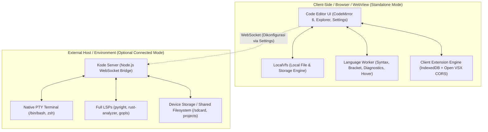

# Arsitektur & Hasil Brainstorming: Kode Editor

Dokumen ini merangkum seluruh ide, pertimbangan teknis, perbandingan kapabilitas, dan keputusan arsitektur yang didiskusikan terkait evolusi **Kode Editor** menjadi editor modern yang fleksibel, ringan, dan dapat berjalan mandiri (*client-side standalone*) maupun terhubung ke lingkungan eksternal (*Termux / PRoot / Server*).

---

## 1. Filosofi & Arah Desain

1. **Kejujuran Teknis (Tanpa Slogan Klise)**
   - Menghindari jargon pemasaran seperti *"0% RAM"*.
   - Menggunakan terminologi teknis yang akurat: **Declarative Extensions** (tema, icon packs, snippets, syntax grammars yang tidak mengeksekusi kode) vs **Runtime Extensions** (ekstensi yang membutuhkan host Node.js VM).
2. **Kemandirian Penuh (*Standalone-First*)**
   - Editor harus dapat langsung dibuka (`npm run dev:app` atau via static web/WebView) dan langsung dapat digunakan untuk mengedit kode tanpa mewajibkan backend server menyala.
   - Tidak ada pop-up koneksi yang mengganggu saat startup. Jika server tidak aktif, editor secara tenang berjalan dalam mode *Standalone Offline*.
3. **Pemisahan Peran: Editor UI vs Heavy Runtime**
   - **Editor UI**: Berjalan di browser / WebView, fokus pada kecepatan render, pengetikan responsif, manajemen file visual, tema, dan linting cepat.
   - **Runtime & Heavy Tooling**: Dijalankan di lingkungan native (Termux di Android, host Linux, atau PRoot container), bukan dipaksakan ke dalam browser jika membutuhkan akses kernel/OS penuh.

---

## 2. Peta Arsitektur: Dual-Mode Architecture

---

## 3. Pembahasan Mendalam: WASM vs Native / PRoot untuk LSP & Tooling

### A. Bisakah Language Server Protocol (LSP) Dijalankan di WASM?

| Aspek | WASM (In-Browser / Web Worker) | Native / Termux / PRoot |
| :--- | :--- | :--- |
| **Kelebihan** | 100% offline, tidak butuh instalasi server, isolasi aman di sandbox browser. | Akses ke seluruh ekosistem toolchains resmi (Rust, Go, Python, C++, Java, Node.js). |
| **Limitasi** | Keterbatasan memori browser, tidak ada direct socket/subprocess spawning, binary LSP besar (sering >50MB). | Butuh setup Termux/PRoot atau backend server lokal. |
| **Kelayakan LSP** | **Bagus untuk:** Parser ringan (Tree-sitter WASM), linter berbasis JS (ESLint/Biome WASM), formatters (Prettier). **Sulit untuk:** `rust-analyzer`, `gopls`, `clangd` (membutuhkan file system indexing besar dan kompilasi kompleks). | **Sempurna untuk:** Semua official language servers standar industri. |

### B. Keputusan Teknis untuk DX (Developer Experience)
- **Lapisan 1 (In-Editor Web Worker / WASM)**:
  - Validasi sintaks instan, bracket matching, smart completion dasar, dan diagnostic error tanpa server melalui `language-worker.ts`.
- **Lapisan 2 (Eksternal via Termux / Server Bridge)**:
  - Ketika pengguna butuh *full code intelligence* (Go to definition lintas modul, refactoring, type checking ketat), editor terhubung ke WebSocket bridge yang menjalankan server LSP asli di Termux/PRoot.

---

## 4. Penyimpanan File & Akses Storage Perangkat

### Kebutuhan Pengguna
> *"Aku butuh file-nya disimpan di storage device kita, bukan di dalam aplikasi atau di dalam PRoot-nya."*

### Solusi & Rencana Integrasi:
1. **Mode Standalone (Browser)**:
   - File default disimpan di VFS browser (`localStorage` / IndexedDB).
   - Menggunakan **File System Access API** (`window.showDirectoryPicker()`) untuk browser modern sehingga pengguna bisa langsung membuka folder lokal dari storage perangkat (`/sdcard/Projects` dsb).
2. **Mode Termux / Android Native**:
   - Jika dijalankan sebagai aplikasi Android (Capacitor/WebView) atau browser terhubung ke Termux:
     - Termux memiliki akses langsung ke `/sdcard` melalui `termux-setup-storage`.
     - Server node di Termux me-mount direktori proyek dari shared storage (`~/storage/shared/Projects`).
     - Hasil editan langsung tersimpan sebagai file asli di HP, mudah di-backup, dipindah, atau dibuka dengan aplikasi lain.

---

## 5. Opsi Terminal: Built-in vs Eksternal Termux

1. **Built-in Web Terminal (Xterm.js via WebSocket)**:
   - Menggunakan server bridge untuk spawn PTY native (`node-pty` atau python fallback).
   - Berguna saat ingin terminal menyatu di bagian bawah editor (*integrated terminal*).
2. **Opsi Eksternal Termux**:
   - Menghubungkan workflow editor dengan aplikasi Termux di luar.
   - Di Android, editor dapat menyediakan tombol/perintah *"Open in Termux"* menggunakan Android Intent URL scheme (`termux://` atau Termux:Tasker / Termux:Open plugin).
   - Pengguna bebas melakukan kompilasi, `git`, atau build script di Termux dengan performa CPU penuh tanpa overhead WebView.

---

## 6. Penanganan Ekstensi Mandiri (Client-Side Extensions)

### Masalah yang Ditemukan Sebelumnya:
1. **Quota Exceeded pada LocalStorage**:
   - File `.vsix` utuh memiliki ribuan SVG dan file JSON yang melampaui batas kuota 5MB browser.
2. **CORS Marketplace**:
   - Microsoft VS Code Marketplace memblokir CORS browser, sedangkan Open VSX (`open-vsx.org`) mendukung CORS penuh.
3. **Broken Icons**:
   - URL icon dipaksa mengarah ke server port 3177 (`/ext-asset`), menyebabkan broken image saat offline.

### Solusi yang Telah Diimplementasikan:
1. **IndexedDB Storage (`kode-extensions-db`)**:
   - Menggunakan IndexedDB untuk menyimpan manifest, tema, dan definisi icon tanpa batasan 5MB.
2. **Selective Unpacking**:
   - Menggunakan pustaka `fflate` untuk ekstraksi hemat memori hanya pada file yang dibutuhkan (manifest, file tema, snippets, icon definitions, dan readme).
3. **Penyelesaian Icon Universal (`resolveIconUrl`)**:
   - Menangani Data URL (`data:image/...`), direct CDN URL (`https://...`), maupun server fallback endpoint secara dinamis.
4. **Registry Open VSX**:
   - Pengunduhan dan pencarian ekstensi langsung dari browser client tanpa memerlukan proxy server.

---

## 7. Desain UX & Kontrol Koneksi yang Rapi

- **Tidak Ada Auto Pop-up**:
  - Modal koneksi otomatis saat disconnect/startup dihilangkan sepenuhnya.
- **Dedicated Settings Section ("Connection")**:
  - Pengguna dapat melihat status koneksi secara *real-time*:
    - `Connected to ws://localhost:3177/ws`
    - `Standalone Mode (Offline — no backend server connected)`
  - Input konfigurasi WebSocket URL server yang tersimpan otomatis.
  - Tombol aksi yang jelas: **Connect / Reconnect** dan **Disconnect (Work Offline)**.

---

## 8. Ringkasan File Kunci dalam Arsitektur

- [`app/src/client-extensions.ts`](file:///public/code-editor/app/src/client-extensions.ts): Mesin pengunduh VSIX, ekstraksi selektif, dan IndexedDB storage.
- [`app/src/extensionsview.ts`](file:///public/code-editor/app/src/extensionsview.ts): UI marketplace & installed cards dengan resolusi icon offline.
- [`app/src/worker/language-worker.ts`](file:///public/code-editor/app/src/worker/language-worker.ts): Service worker client-side untuk analisa kode & linting.
- [`app/src/worker/client-lsp.ts`](file:///public/code-editor/app/src/worker/client-lsp.ts): Jembatan antara worker bahasa dan CodeMirror.
- [`app/src/localvfs.ts`](file:///public/code-editor/app/src/localvfs.ts): Virtual file system in-memory/browser saat server tidak terhubung, sekaligus *shim* RPC `fs.*`/`ws.*`/`settings.*`/`ext.*`/`doc.*`/`pty.*`.
- [`app/src/localfs.ts`](file:///public/code-editor/app/src/localfs.ts): Akses folder nyata di storage perangkat via **File System Access API** (`showDirectoryPicker`) + persistensi handle di IndexedDB.
- [`app/src/settingsview.ts`](file:///public/code-editor/app/src/settingsview.ts): Panel pengaturan terpadu termasuk konfigurasi Server Connection.
- [`app/src/connect.ts`](file:///public/code-editor/app/src/connect.ts): Helper dialog koneksi yang kini beroperasi secara pasif / non-intrusif.
- [`app/src/terminal.ts`](file:///public/code-editor/app/src/terminal.ts): Terminal xterm.js yang mendeteksi mode offline lebih awal dan memberi petunjuk koneksi, bukan menunggu timeout.

---

## 9. Status Implementasi Mode Tanpa Server (Standalone)

Seluruh jalur kode yang tadinya hanya bergantung pada server Node kini memiliki fallback klien:

1. **RPC offline tanpa delay**
   - `Bridge.request()` merutekan `fs.*`, `ws.*`, `settings.*`, `ext.*`, `lsp.*`, `doc.*`, `pty.*`, dan `server.info` ke `LocalVfs` saat WebSocket belum tersambung — tidak ada lagi penantian timeout 3 detik.
   - `doc.*` bersifat no-op (client LSP tetap menerima `didOpen`/`didChange`), `pty.spawn` gagal cepat dengan pesan yang jelas.
2. **Terminal sadar-offline**
   - Tidak mengulang percobaan spawn setiap ketikan; menampilkan satu petunjuk dan otomatis siap kembali saat status server berubah menjadi *connected*.
3. **Open Folder nyata dari perangkat**
   - Saat offline, tombol **Open Folder** memakai `window.showDirectoryPicker()`; file dibaca/ditulis langsung ke storage HP, handle disimpan di IndexedDB untuk restore.
   - Fallback ke workspace virtual bila browser tidak mendukung File System Access API.
4. **Pencarian file**
   - `ws.search` offline menghormati `caseSensitive`, `regex`, `wholeWord`, dan `maxResults`, serta mengembalikan bentuk `{ files, matchCount, truncated }` yang sama dengan server.
5. **Ikon ekstensi**
   - Helper `resolveAssetUrl()` mengembalikan `data:`/`http(s):` apa adanya dan hanya menambahkan origin server bila benar-benar tersambung; ikon tidak lagi pecah saat offline.
6. **Tema & ikon ekstensi klien**
   - `SettingsView` mengenali id tema `client:<ext>:<path>` (bukan hanya `ext:`), sehingga tema warna dan icon theme dari IndexedDB benar-benar diterapkan saat standalone.
7. **Ekstensi declarative vs runtime**
   - Install langsung dari URL VSIX bekerja di klien (`clientExtensions.installVsix`).
   - Menjalankan kode ekstensi runtime ditolak dengan pesan yang menjelaskan butuh server; tema/ikon tetap berfungsi tanpa server.
8. **Koneksi & startup**
   - `Bridge.waitForConnection()` memberi server yang berjalan kesempatan menjawab sebelum memutuskan mode offline, menghilangkan balapan saat startup.
   - `setUrl("")` (Disconnect / Work Offline) tidak lagi membuat `WebSocket` tidak valid; tidak ada pop-up koneksi otomatis.
